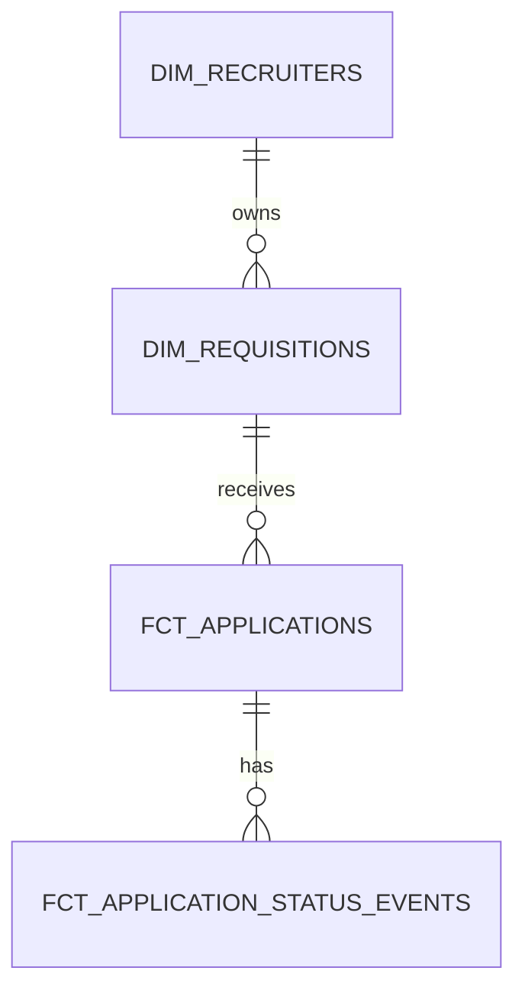

# Talent Acquisition Data Pipeline

An ELT portfolio project that turns synthetic recruitment snapshots into validated reporting tables using **Amazon S3, Snowflake, dbt, and Apache Airflow**.

I built this project to practise data engineering using a domain I am familiar with: talent acquisition. The focus is on handling changing daily extracts, identifying data-quality issues, and making the processing steps repeatable and visible in Airflow.

**Current status:** The manually triggered pipeline has been run successfully for the mock data, including a repeat load and a missing-file failure check. Power BI reporting and daily scheduling are planned.

## Contents

- [Architecture](#architecture)
- [Source data](#source-data)
- [Transformation and reporting models](#transformation-and-reporting-models)
- [Data quality](#data-quality)
- [Orchestration](#orchestration)
- [Validation results](#validation-results)
- [Repository structure](#repository-structure)
- [Running the project](#running-the-project)
- [Design choices and limitations](#design-choices-and-limitations)
- [Next steps](#next-steps)

## Architecture

```mermaid
flowchart LR
    CSV["Synthetic TA extracts<br/>Four CSV files per snapshot"]
    S3["Amazon S3<br/>Dated snapshot folders"]

    subgraph SF["Snowflake · TA_DATA_DB"]
        STAGE["External stage<br/>TA_S3_STAGE"]
        RAW["RAW tables<br/>Snapshots and ingestion metadata"]
        STG["dbt staging views<br/>Clean, parse and deduplicate"]
        INT["dbt intermediate views<br/>Validate records and audit history"]
        MART["Reporting tables<br/>Dimensions and facts"]
        REJECT["Rejected applications<br/>Reasons retained for inspection"]
    end

    subgraph LOCAL["Local Docker environment"]
        AF["Apache Airflow + Cosmos<br/>File checks, loading, dbt tasks<br/>and reporting verification"]
    end

    BI["Power BI<br/>Planned"]
    CSV -->|Upload| S3
    S3 -->|Storage integration and IAM role| STAGE
    STAGE -->|COPY INTO| RAW
    RAW --> STG --> INT
    INT --> MART
    INT --> REJECT
    MART -.-> BI
    AF -.->|Check files and load| STAGE
    AF -.->|Run models and tests| STG
    AF -.->|Verify counts and date| MART

    classDef source fill:#fff3df,stroke:#b87712,color:#222;
    classDef warehouse fill:#eaf5ff,stroke:#2475a8,color:#222;
    classDef orchestration fill:#e7f5ef,stroke:#27825b,color:#222;
    classDef quality fill:#fff0ed,stroke:#bd6452,color:#222;
    classDef planned fill:#f3f3f3,stroke:#888,color:#444,stroke-dasharray:5 5;
    class CSV,S3 source;
    class STAGE,RAW,STG,INT,MART warehouse;
    class AF orchestration;
    class REJECT quality;
    class BI planned;
```



Solid arrows show data flow. Dashed arrows show orchestration or the planned reporting connection. dbt SQL runs in Snowflake; Airflow runs locally in Docker and coordinates the work.

The layers above are logical layers. RAW data lives in `TA_DATA_DB.RAW`. With the current configuration, staging views, intermediate views, and marts tables all live in `TA_DATA_DB.STAGING`. The dbt folder names do not create separate Snowflake schemas.

## Source data

All records are synthetic and cover recruitment activity across APAC countries. Each dated S3 folder contains a complete snapshot of four datasets:

| Dataset | Grain within a snapshot | Main fields |
|---|---|---|
| Job requisitions | One requisition | Job title, grade, business area, country, recruiter, status, approval and closure dates |
| Applications | One application | Requisition, candidate, application status, country and application date |
| Recruiters | One recruiter | Recruiter name and organisational unit |
| Application status audit | One status-change event | Application, status and change timestamp |

```text
s3://<bucket>/ta/snapshots/
├── 2026-10-08/
│   ├── job_requisitions.csv
│   ├── applications.csv
│   ├── recruiters.csv
│   └── application_status_audit.csv
└── 2026-10-09/
    └── The same four filenames
```

A candidate can submit multiple applications, and one recruiter can own multiple requisitions. Application counts therefore differ from candidate counts.

Each audit snapshot contains the complete status history available on that date. Reporting models select one snapshot rather than combining repeated copies of historical events from multiple extracts. `snapshot_date` identifies the extract; it is not the date of every business event in that extract.

Application statuses are New Application, Screening, Hiring Manager Interview, Interview, Offer, and Hired. Requisition status is Open or Closed. Closure does not necessarily mean a candidate was hired.

## Transformation and reporting models

| Layer | Responsibility | Materialisation |
|---|---|---|
| RAW | Preserve source values, snapshot dates, filenames, row numbers, content keys and ingestion timestamps | Snowflake tables |
| Staging | Select the common snapshot date, trim strings, parse dates and timestamps, remove exact duplicates | dbt views |
| Intermediate | Validate requisitions, applications and audit events; identify latest valid audit status; retain rejection reasons | dbt views |
| Marts | Publish valid records for analysis and rejected applications for investigation | dbt tables |

The reporting models are:

| Model | Grain and purpose |
|---|---|
| `dim_recruiters` | One recruiter in the selected snapshot |
| `dim_requisitions` | One valid requisition, including requisitions with no applications |
| `fct_applications` | One valid application and its current status |
| `fct_application_status_events` | One valid status event belonging to an accepted application |
| `rejected_applications` | One rejected application with its validation reason |



The joins use `recruiter_id`, `job_req_id`, and `application_id`, respectively. This diagram describes the selected-snapshot reporting model, not historical recruiter ownership. Relationships are checked through dbt tests where configured; the diagram does not imply enforced Snowflake foreign keys.

## Data quality

The first snapshot intentionally contains issues such as duplicate records, missing candidate IDs, unknown recruiters or requisitions, invalid dates, orphan audit events, and differences between an application's current status and its audit history.

Staging removes exact duplicates. Intermediate models assign a `rejection_reason` and an `is_valid` flag. An invalid parent requisition also prevents its applications from entering the reporting fact. An application with rejected audit events or a current status inconsistent with its latest valid event is rejected as well.

Rejected applications remain available for inspection rather than disappearing from the pipeline. The second snapshot corrects the documented issues and adds business changes and new applications.

Checks include:

- Required fields and uniqueness at the appropriate model grain.
- Accepted application statuses and configured relationship tests.
- Date validity, chronology and consistency with the selected snapshot.
- Expected RAW and reporting row counts for each mock snapshot.
- Confirmation that every reporting row belongs to the requested snapshot date.

See [data_quality_issues.md](data_quality_issues.md) and [expected_results.json](expected_results.json) for the fixture details and expected results.

## Orchestration

The `ta_ingestion` DAG accepts a `snapshot_date` parameter and runs:

1. **Check files:** confirm all four required CSV files are present in the dated external-stage path.
2. **Load and verify RAW:** execute `COPY INTO` for each dataset, then check its snapshot row count.
3. **Transform and test:** use Cosmos `DbtTaskGroup` to display individual dbt models and tests in Airflow's Graph view.
4. **Verify reporting:** check the final row counts and snapshot dates.

The date returned by the load task is passed into dbt as `ta_snapshot_date`. This overrides the project's default date for the run. The DAG uses `schedule=None`, `catchup=False`, and `max_active_runs=1`.

Snowflake reads S3 through its storage integration and IAM role. Airflow uses the `ta_snowflake` connection to access Snowflake. The dbt project is bind-mounted into the containers, so the repository contains one maintained copy of the model code.

## Validation results

The following results were confirmed during local project runs:

| Reporting output | 2026-10-08 | 2026-10-09 |
|---|---:|---:|
| Recruiters | 5 | 5 |
| Valid requisitions | 17 | 20 |
| Valid applications | 81 | 102 |
| Rejected applications | 19 | 0 |
| Status events for accepted applications | 278 | 357 |

For the first snapshot, **100 staged applications = 81 valid + 19 rejected**. The second snapshot contains **92 distinct candidates**, with **15 open and 5 closed requisitions**.

| Scenario | Observed outcome |
|---|---|
| Process the second snapshot | Models, tests and reporting checks pass |
| Repeat the same snapshot load | RAW counts remain unchanged for the recognised files |
| Request the next day without source files | File check fails and downstream processing does not execute |

These are local demonstration results, not evidence of production operation or load testing.

## Repository structure

```text
ta-data-pipeline/
├── sql/                         # Snowflake setup and manual load scripts
├── ta_dbt/
│   ├── models/
│   │   ├── staging/             # Sources and cleaned models
│   │   ├── intermediate/        # Validation and audit logic
│   │   └── marts/               # Dimensions, facts and rejected applications
│   └── dbt_project.yml
├── airflow/
│   ├── dags/
│   │   ├── ta_connection_check.py
│   │   └── ta_ingestion_dag.py
│   ├── Dockerfile
│   ├── requirements.txt
│   └── docker-compose.override.yml
├── data_quality_issues.md
├── expected_results.json
└── project_checklist.md
```

`project_checklist.md` is the original planning checklist, not a record of completed functionality. This README describes the implemented scope.

## Running the project

### Prerequisites

- An AWS account and a private S3 bucket containing the four mock CSV files for each supported snapshot.
- A Snowflake account with permissions to create the project objects and configure the S3 storage integration.
- Docker Desktop with a working Linux-container backend and the Astro CLI.
- Git and an editor. A separate local dbt installation is optional for developing models outside Airflow.

The local `data/` directory is excluded from Git. A fresh clone therefore does not include the CSV fixtures; provide files matching the source contract and expected counts before running this demo.

### 1. Configure AWS and Snowflake

Keep S3 public access blocked. Configure the Snowflake reader IAM role and the storage integration trust relationship for your own account. Adapt account-specific values in the SQL scripts before executing them.

Run the setup scripts in this order:

1. `sql/01_bootstrap.sql`
2. `sql/02_snowflake_s3_intergration.sql`
3. `sql/03_stage_and_raw_tables.sql`

The configured defaults are database `TA_DATA_DB`, warehouse `TA_DATA_PROJECT_WH`, role `TA_DATA_ENGINEER`, and stage `TA_DATA_DB.RAW.TA_S3_STAGE`. Ensure the role has the required RAW loading privileges and permissions to create dbt tables and views in the output schema.

The `04_load_snapshot.sql` and `05_load_second_snapshot.sql` files document the manual loading path used during development. Airflow performs those loads during orchestrated runs.

### 2. Start local Airflow

From the repository root:

```powershell
cd airflow
astro dev start
```

The Dockerfile installs `dbt-snowflake` in a separate virtual environment. The Compose override mounts `../ta_dbt` at `/usr/local/airflow/dbt/ta_dbt`.

### 3. Configure the Snowflake connection

In Airflow, create a Snowflake connection named `ta_snowflake` with your account identifier and login credentials. The current Cosmos mapping uses username/password authentication; accounts requiring another method need the corresponding profile mapping.

Set the database, warehouse and role to the values above and the schema to `STAGING`. Keep credentials in the connection, not in DAG code or Git. Run `ta_connection_check` to verify access and session settings.

### 4. Trigger the pipeline

Unpause `ta_ingestion` and trigger a manual run with:

```json
{
  "snapshot_date": "2026-10-09"
}
```

Open Graph view and expand `dbt_models` to inspect the model dependencies and tests. Verify that `verify_reporting` passes. Repeat the run to check recognised-file reload behaviour.

To exercise the missing-file path, trigger `2026-10-10` only when that folder is absent. The file-check task should fail and downstream tasks should not execute.

### 5. Stop the local environment

From the `airflow` directory:

```powershell
astro dev stop
```

Keep Snowflake warehouse auto-suspend enabled to limit idle compute usage. Generated dbt artifacts, local environment files and credentials are excluded through `.gitignore`.

## Design choices and limitations

- **ELT:** CSV data is loaded into Snowflake before dbt transformations run there.
- **Snapshots retained in RAW:** RAW appends dated extracts. Current reporting tables are rebuilt for one selected snapshot; they are not historical daily fact tables or slowly changing dimensions.
- **Known demo inputs:** Counts are configured for October 8 and 9. New dates require new files and expected-count configuration before they can be processed.
- **File-level reload protection:** `FORCE = FALSE` relies on Snowflake's retained file-load metadata. It is not permanent business-key deduplication, and dated input files should be treated as immutable.
- **No atomic publication:** The four COPY operations and the dbt model builds are separate operations. Partial RAW loads or partially refreshed reporting models can remain after a failure. There is no transactional whole-pipeline rollback or snapshot-readiness registry.
- **Local orchestration:** Airflow runs on a local machine, not on a managed cloud deployment. A schedule would require the environment to stay running and new source files to arrive.
- **Concurrency:** One active DAG run prevents this DAG's runs from overlapping. It does not prevent a separate manual dbt run from modifying the same output tables.
- **Audit semantics:** The event fact excludes events belonging to rejected applications. It is a curated reporting dataset, not a complete copy of RAW audit records. The synthetic fixture assumes distinct event timestamps within an application after exact duplicate removal.

## Next steps

- Build Power BI visuals for current recruitment activity and historical application progression.
- Add screenshots of the expanded Airflow graph, a successful run and the missing-file failure path.
- Make the mock fixture generation reproducible from a fresh clone.
- Replace fixed demo counts with a source manifest or configurable batch contract.
- Add a snapshot-readiness and publication strategy before introducing regular scheduling.
- Pin tested dependency versions and add automated checks for future code changes.

## References

- [Snowflake COPY INTO](https://docs.snowflake.com/en/sql-reference/sql/copy-into-table)
- [dbt data tests](https://docs.getdbt.com/docs/build/data-tests)
- [Astronomer Cosmos](https://astronomer.github.io/astronomer-cosmos/)
